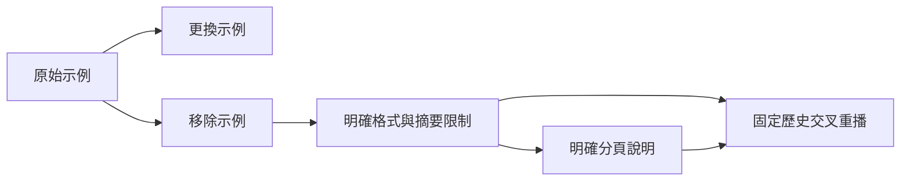

# d06：Prompt 與工具描述如何影響 Agent 路徑

問題：**On what date will version 1 of the GridLens API be shut down?**

接受日期為 **2026-12-31**，位於 [API spec 第 120 行](record/evidence/ground-truth-api-spec.md)。這是事後判準，不加入模型 request。已保存 5 個環境、6 個完整 runs、7 個 probes、4 個 replays；所有完整 runs 仍未命中日期。

先看[精簡 run 總覽](record/OVERVIEW.md)，或在瀏覽器開啟 [record/index.html](record/index.html)。每次 run 使用通用 trace 格式；完整 request、completion、工具結果與 aux 預設收合。

| 修改 | 觀察 | 代表紀錄 |
|---|---|---|
| E0 原始 email 示例 | 先查四次 email，讀 release notes，錯用更新日期 | [原始 run](record/runs/historical/trace.md) |
| E1 示例換為 search_docs | 起手改查文件，完整 run 仍未讀文件 | [E1 run](record/runs/b-full/trace.md) |
| E2 直接移除示例 | 三次 probe 均缺少外層 name／args | [格式錯誤 probe](record/runs/c-probe1/trace.md) |
| E3 明確格式與 snippets 限制 | 呼叫合法，但 API spec 只讀 1–89/131 行，未接續 | [E3 run](record/runs/protocol-after/trace.md) |
| E4 明確 read_doc 分頁描述 | 本次完全沒呼叫 read_doc，仍未答對 | [E4 run](record/runs/paging-after/trace.md) |
| 固定歷史交叉替換描述 | 描述與歷史共同影響下一步；未執行工具 | [交叉 replay](record/runs/replay-new-old/trace.md) |

工具格式、選擇正確文件、讀到支持段落與答案命中分開評估。d09 曾在 E0 成功翻頁，見[20 題對照](../baseline-20/README.md)；不能將 d06 歸因為模型完全不具備翻頁能力。這是單題探索，不能代替 E4 全體評估。

[完整研究解讀與限制](RESEARCH.md) · [詳細比較介面](record/research.html) · [原始證據 hashes](record/integrity.json) · [研究 manifest](manifest.json)

重跑：`uv run agent-trace run --task d06 --agent current`。預設新 run 會直接產生 trace，不需要 build；只有整理歷史研究頁才執行 `uv run agent-trace build`。
