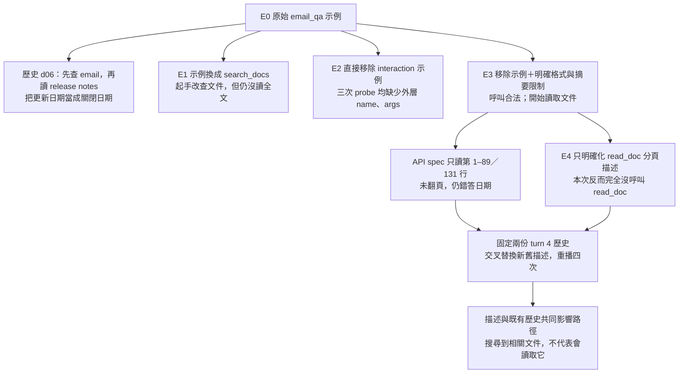
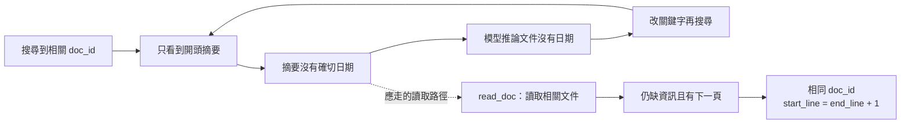
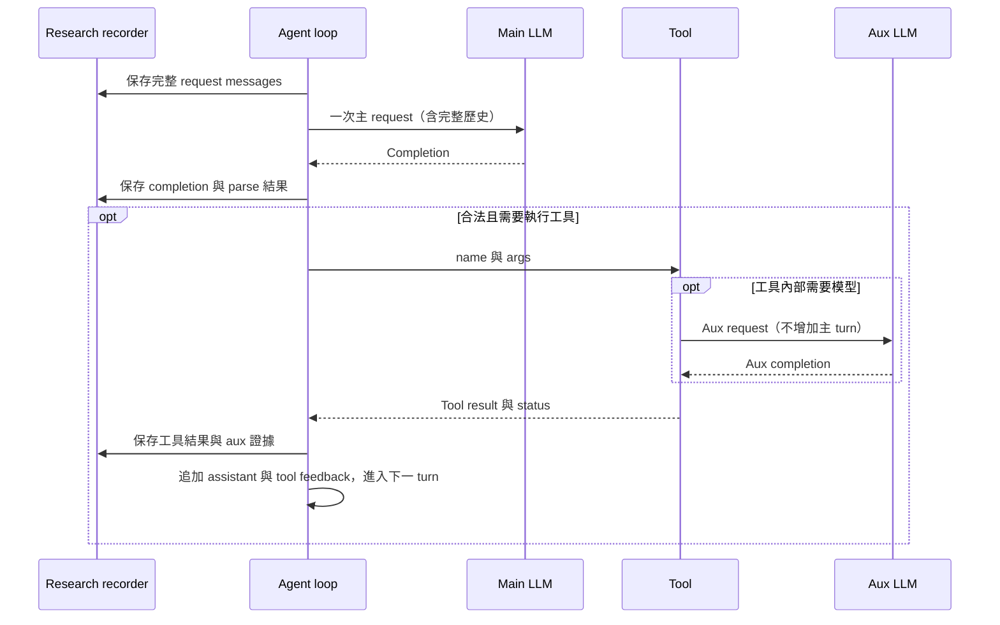

# d06：追蹤 Prompt 修改如何影響 Agent 的工具路徑

這份研究紀錄追蹤一個問題：**移除偏向 email 的 in-context example 後，如何讓 agent 維持合法工具呼叫，並讀到足以支持答案的文件內容？**

我們保存每次實驗的完整 system prompt、工具描述與 schema，以及每個 turn 的實際輸入、completion、工具意圖與執行結果。已納入 **5 個環境版本、6 個完整 runs、7 個起手 probes、4 個固定歷史 replays**，共 **46 次主 LLM requests、8 次 aux requests**。

> 這是單題 d06、單一本機模型的探索紀錄。所有完整 runs 仍未答對；工具格式改善、路由改善與最終答案正確是不同指標。本紀錄不代表 Problem 9 的 20 題評測通過。

- **快速閱讀：**下面的探索流程、實驗結果與錯誤模式。
- **核對證據：**[所有紀錄總表](record/OVERVIEW.md) → 各 run → 各 turn 的完整 request / completion / tool result。
- **深入瀏覽：**在 repo 根目錄執行 `uv run agent-trace build`，再用瀏覽器開啟本機的 `studies/d06/record/index.html`。HTML 閱讀頁由保存紀錄重建，不納入版本控制。
- **可重建資料：**[manifest](manifest.json)、[結構化紀錄](record/records.json)、[SHA-256 與完整性驗證](record/integrity.json)。

## 問題與判準

原始問題：`On what date will version 1 of the GridLens API be shut down?`

正確答案為 **2026-12-31**，位於 [API spec 證據快照](record/evidence/ground-truth-api-spec.md)第 120 行。這個答案只用於事後分析，沒有加入模型的 system prompt。模型為 `qwen3.5:4b-q4_K_M`；後續有保存 HTTP 的實驗使用 `temperature=0`、`think=false`、`num_ctx=8192`。早期未保存的設定與 native token 數保持「未記錄」，不以後來設定回填。

## 探索流程



各環境快照包含 system prompt 內當時的工具說明與 schema；點擊 diff 可比對原文。

| 階段 | 修改與假設 | 觀察結果 | 環境與證據 |
|---|---|---|---|
| 01 原始路徑 | 先定位失敗，不改 prompt | 7 turns；4 次 email 搜尋；沒讀 API spec，錯答 `2026-08-25` | [E0](record/environments/E0.system.txt) · [歷史 run](record/traces/historical.md) |
| 02 示例消融 | A 保留 email 示例；B 同示例換成文件工具；C 移除 interaction 示例 | A 三個起手皆 `email_qa`；B 三個皆 `search_docs`；C 三次 probe 皆格式錯誤。A/B 完整 run 都未答對 | [E1 diff](record/environments/E1.diff) · [E2 diff](record/environments/E2.diff) · [C 格式錯誤](record/traces/c-probe1.md) |
| 03 格式與摘要說明 | 明確對齊 Tool 名稱、args 與 schema；search_docs 明示只回傳摘要，必要時 read_doc | 所有呼叫合法；read_doc 由 0 次變 2 次；仍未翻頁，錯答 `2027-08-25` | [E3 diff](record/environments/E3.diff) · [控制組](record/traces/protocol-before.md) · [修改後](record/traces/protocol-after.md) |
| 04 分頁描述 | 只改 read_doc：部分文件、1500 tokens、end_line 小於 total_lines 時繼續 | 6 turns；4 次文件搜尋＋1 次 email 搜尋；0 次 read_doc，無法確認日期 | [E4 diff](record/environments/E4.diff) · [本次 run](record/traces/paging-after.md) |
| 05 固定歷史重播 | 分別固定前次、本次的 turn 4 歷史，只切換新舊 read_doc 描述 | 選擇受描述與歷史共同影響；換回舊描述不一定恢復 read_doc | [舊歷史＋舊描述](record/traces/replay-old-old.md) · [舊歷史＋新描述](record/traces/replay-old-new.md) · [新歷史＋舊描述](record/traces/replay-new-old.md) · [新歷史＋新描述](record/traces/replay-new-new.md) |

「三個起手」包含兩次獨立起手 probe 與完整 run 的第一個 request；C 則是三次 probes。這些不是三次完整 run。

## 定位出的錯誤模式

### 1. 合法工具呼叫與正確工具選擇要分開看

直接移除示例時，模型曾輸出只有 `query`、`k` 的 JSON，漏掉外層 `name`、`args`。明確解釋格式與 schema 的對應後，本次完整 runs 中所有工具呼叫都合法，但答案仍錯。

[查看格式失敗的完整 completion](record/traces/c-probe1.md#turn-1)。probe 沒有執行工具，不能將其標成「工具成功」。

### 2. 「摘要沒有」被擴大為「文件沒有」

E4 的 turn 2 只收到搜尋摘要，便寫出 API spec 沒有說明 v1 何時關閉。四次文件搜尋回傳 20 筆結果，實際只有 5 份不同文件；API spec 每次都在其中，摘要卻都停留在文件開頭約第 1–14 行。

目前檢索依全文排名，但摘要從第一個命中查詢詞的位置開始擷取。`GridLens`、`API`、`version` 容易先命中標題或導言，所以改寫搜尋詞未必帶來新段落。



[從這個偏差首次出現的 turn 2 開始核對](record/traces/paging-after.md#turn-2)。不相關 email 是 turn 4 才引入，時間上晚於這個偏差。

### 3. 讀到文件不等於讀到答案

E3 的 API spec 只回傳第 1–89 行，共 131 行；模型沒有繼續從第 90 行讀取。正確日期在第 120 行，因此沒有進入任何 request。之後 E4 完全沒呼叫 read_doc，**未進入翻頁階段，無法驗證新的分頁指引是否有效**。

[查看 E3 turn 5 的工具結果與 turn 6 的最終 completion](record/traces/protocol-after.md#turn-5)。

### 4. 描述改動從第一個 request 就生效，歷史會繼續累積

工具描述全部放在 system prompt 中，不是等到要呼叫該工具時才加入。因此，只改 read_doc 的描述，從 turn 1 就改變了整個輸入；早期不同的 completion 與工具結果又會進入後續歷史。

為區分這兩個因素，固定 turn 4 前的完整 messages，只替換新舊 read_doc 描述，各重播一次：

| 固定的歷史 | 舊描述 | 新描述 |
|---|---|---|
| E3 run 的歷史 | `read_doc` | `search_docs` |
| E4 run 的歷史 | `search_docs` | `search_emails` |

這個對照支持描述與歷史共同影響選擇。每格只有一次，不能推論模型內部心理原因或一般穩定效果。兩個控制重播雖重現工具選擇，completion 文句並未逐字相同。

## 每個 turn 保存什麼



- **Run**：處理一次原始問題，可能包含多個主 turns。
- **Turn**：一次主 LLM request / response；工具內的 aux 不另計主 turn。
- **Request / prompt**：本紀錄的完整 messages；system、原始問題、歷史 completion 與完整工具 feedback 都能查看。
- **Completion**：`response.message.content`，包含模型可見輸出的文字與工具呼叫；不能視為內部思考。
- **Tool calling**：分開顯示解析狀態、參數、實際執行狀態、完整結果。probe / replay 不執行工具。
- **Tokens**：native 數值來自 HTTP response；課程估算另列。未記錄者不補值。

逐 run Markdown 預設呈現 completion 與執行狀態；完整 messages、工具結果與 aux 可展開。互動頁可切換 turn、查看全部／新增 messages、比對任意兩版環境，並用網址 hash 指向特定 turn。

## 證據界線

1. 保存的 application request 皆可核對至 JSONL；後期的 HTTP payload 另與 messages 比對，避免把兩者當成兩次模型呼叫。
2. 原始 JSONL 逐位元組複製並保存 SHA-256。研究說明與原始事實分開，沒有改寫歷史輸出來符合敘事。
3. 最初 7 個 turns 沒有 HTTP JSON；模型 digest、native tokens 或程式碼快照若未保存，就無法事後證明。來源 hash 也不等於完整程式碼快照。
4. `done` 只表示 agent 停止；工具 `ok` 只表示執行成功；日期字串比對不是語義評分。這些不應混為「通過」。
5. 實驗 03 同時改了格式說明與 search_docs 描述，不能分開歸因。固定歷史重播每格一次，temperature=0 不代表獨立統計樣本或永遠逐字一致。

## 重建與後續紀錄

從 repository 根目錄執行，不呼叫模型：

```powershell
uv run python -m agent_trace.notebook
```

輸出在 `studies/d06/record/`。若原始 `runs/` 不在 checkout 中，builder 會使用本目錄已保存的 evidence / metadata 副本重建。瀏覽與核對不依賴未納入 Git 的原始 runs，也不需要啟動 Ollama。

若瀏覽器不方便直接開本機檔案，可在根目錄啟動只供本機閱讀的 server：

```powershell
uv run python -m http.server 8765 --bind 127.0.0.1 --directory studies/d06
```

然後開啟 `http://127.0.0.1:8765/record/`。

下一個實驗沿用同一結構：

1. 在實驗前保存完整 system prompt、工具 schema、模型設定、模型 digest 與程式碼版本。未提交變更另外保存 patch。
2. 寫下假設、唯一改動與控制組，執行後保留完整 JSONL 與 HTTP JSON；probe 與完整 run 分開標示。
3. 在 [manifest](manifest.json) 新增 run、stage、觀察、解讀限制與重要 turn。新增 prompt 版本會依 SHA-256 分組，可在 manifest 的 environment_versions 中命名。
4. 重建紀錄，確認 SHA-256、request 對應與頁面可讀性。將新觀察追加為新版本，不覆寫舊證據。

builder 與 reader 的修改不會改動 agent prompt 或工具實作。本紀錄建立時沒有新增模型實驗。

## 可讀性與完整性檢查

- 7 項資料處理測試通過：包含 aux 關聯、未執行的 probe、缺少 completion、HTTP 與 application 不一致時拒絕產出。
- 12 項本機瀏覽器檢查通過：1360px 桌面與 390px 窄螢幕、turn 連結與重新載入、完整 messages 逐字對應、新增內容切換、工具原文、aux、未執行狀態、精簡／完整 diff、篩選及 JavaScript 錯誤檢查。
- Markdown 檔案連結已核對，沒有失效檔案連結。原始證據副本與 request exports 已驗證；另在沒有原始 runs 目錄的模擬 checkout 中成功重建。

上述為當時的本機 QA 紀錄；截圖與工作站驗證快照不納入公開 repo。新版可執行 tests 與發布驗證見 [重現說明](../../docs/reproducibility.md)。

資料處理測試可從根目錄執行：

```powershell
uv run pytest
```


## 獨立專案版本

本目錄的原始 JSONL 與歷史 prompt 保留原樣。獨立 runtime 的操作方式與驗證結果請見[專案首頁](../../README.md)。此處記載的 7 項資料測試與 12 項 UI 檢查屬於原版記錄工具的歷史驗證，獨立專案另有自己的測試。
